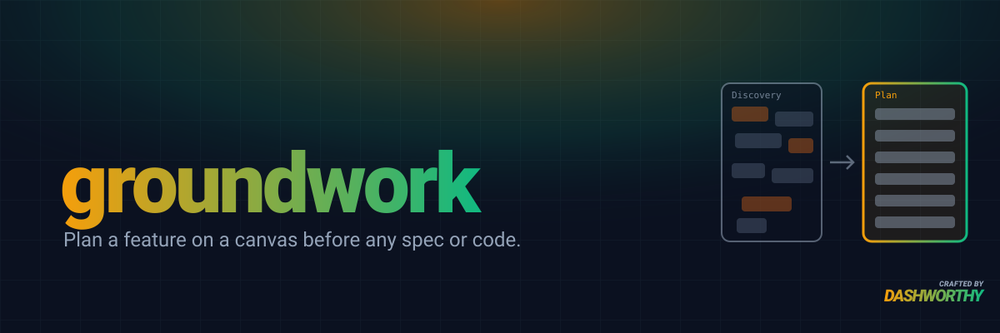

<p align="center">
  
</p>

# groundwork

A Claude Code plugin that turns a feature ticket into an agreed plan on a tldraw canvas, before anyone writes a spec or a line of code.

## What it does

- **Maps today's code** in the background: the tables, every hard-coded assumption, every action and automation the feature touches, with file:line.
- **Lays out a Discovery page:** the ask, gaps in the logic (including the ones you didn't raise), process flows, a today-against-proposed behaviour matrix, decisions with recommended defaults, and follow-ups for bugs it found along the way.
- **Walks you through it one item at a time.** You answer by ID ("G3. Yes", "Proposals for G7?"); every answer is checked against the code and written to every card and flow it touches, and each reply ends with a status table and the next item.
- **Checks every feature against 14 standards:** one resolver for each changed default, backfills, reasons on every change, never blocking the field, the backend deciding, lifecycle guards, permissions, and more.
- **Builds the Plan page and mockups only after you agree the flows:** data, behaviour and pages, with mockups built from the project's real components and existing page layouts.

## Requirements

- [tldraw Desktop](https://www.tldraw.com/) and the `tldraw-offline` skill, which the plugin uses to read and draw the canvas. Without them it offers to run the same sections in a markdown file with mermaid flows.

## Install (Claude Code)

```
/plugin marketplace add dashworthy/groundwork
/plugin install groundwork@groundwork
```

## Use it

```
/groundwork <feature or ticket>
```

Example: `/groundwork let one tenant run several warehouses`

You can also say "help me plan X before we write specs" or "find the holes in this ticket's logic", and the `discovering-features` skill triggers on its own.

## Output

A tldraw canvas, by default `~/Desktop/<Project> <Feature>.tldraw`, with two pages:

- **Discovery:** the full history: overview, gaps, flows, behaviour matrix, decisions, follow-ups.
- **Plan:** only the agreed outcome: data, behaviour, pages, and a link to the mockups Artifact.

Hand the Plan page to your spec workflow (OpenSpec, `engineering:spec`, or your own) one slice at a time.

**Resume:** open the same canvas in a later session and the skill rebuilds the status table from the card states, then picks up the unreviewed items without re-asking settled ones.

## Works in Claude Code and Codex

Two manifests share one `skills/` directory:

- `.claude-plugin/plugin.json` for Claude Code (plus the `/groundwork` command).
- `.codex-plugin/plugin.json` for Codex.

## Evals

A `claude plugin eval` suite lives in [`evals/`](evals/). It checks that the skill fires on feature planning and gap hunting, stays quiet on one-line changes, holds the gate when asked to jump to mockups early, and answers a review reply with the trade-off, the updated flows, the status table and one next item.

## Structure

```
groundwork/
├── .claude-plugin/plugin.json             # Claude Code manifest
├── .claude-plugin/marketplace.json        # Claude Code marketplace (this repo)
├── .codex-plugin/plugin.json              # Codex manifest (shares skills/)
├── commands/groundwork.md                 # /groundwork entry point
├── skills/discovering-features/
│   ├── SKILL.md                           # the workflow
│   └── references/
│       ├── canvas-layout.md               # sections, card templates and states, Plan page
│       ├── review-loop.md                 # handling answers, reply template, questions
│       ├── standards.md                   # the 14 standards
│       └── codebase-map.md                # background agent brief, evidence rules
└── evals/                                 # claude plugin eval suite
```
